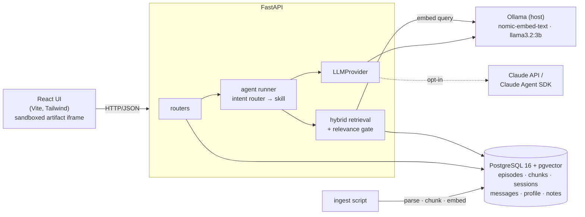

# Lenny Growth Assistant

**Ask Lenny's Podcast anything, and get answers you can trust.** Every claim cites the episode, the guest and the exact second on YouTube. When the 303 transcripts don't cover a question, the assistant says so instead of guessing. It runs **fully on your laptop with Ollama**. Claude is an opt-in switch.

<p align="center">

<br><sub> </sub>
</p>

| | |
|---|---|
| **Grounded Q&A** | Hybrid search (pgvector + Postgres full-text, RRF). A relevance gate refuses *before* the model is called. Citations come from retrieved chunks, never from model output. |
| **Ship 30 for 30 essays** | A dedicated skill encodes the Ship 30 principles: hook, "for who / so that", 1-3-1 rhythm, skimmable format, one actionable takeaway. Generated section by section to reach about 1,250 words on small models. |
| **Artifacts** | Markdown docs and HTML/CSS cards render beside the chat in a **sandboxed iframe**: no same-origin, scripts off by default, CSP, forms and links neutralised. |
|**Learner modes** | Explain simply (analogies tied to your profile), Quiz me, PRD Architect, a saved notes library, a transcript browser. |
|  **Model toggle** | `LLM_PROVIDER=ollama \| claude \| claude-agent`, switched with no code change. The active provider shows in the UI. There is no silent cloud fallback. |
|**Operable** | One-command Docker Compose, JSON logs with request IDs, structured errors, health endpoints, resumable ingestion. |

---

## Architecture



| Layer | Owns | Never does |
|---|---|---|
| `backend/app/routers/` | HTTP contracts, validation, persisting turns | Prompting, retrieval SQL |
| `backend/app/agent/` | Intent routing, prompts, skills (`ask`, `explain`, `quiz`, `ship30`, `artifact`, `prd`) | Talk to a specific vendor |
| `backend/app/providers/` | One class per model backend behind `LLMProvider` | Retrieval, routing |
| `backend/app/retrieval.py`, `embeddings.py` | Hybrid search, relevance gate, vectors (same model for docs and queries) | Generate answers |
| `backend/app/ingestion/`, `scripts/ingest.py` | Parse YAML headers, chunk (~500 words, 50 overlap, timestamps kept), embed, store | Serve requests |
| `frontend/src/` | Chat, citations, artifact viewer, sandboxing (`lib/sandbox.js`) | Business rules |

The full schema, API, ingestion flow, security model and deployment topology are in [`docs/architecture.md`](docs/architecture.md).

---

## Quick start

### Prerequisites
* **Docker Desktop** (or Docker Engine + Compose v2)
* **[Ollama](https://ollama.com/)** running on the host, with two models:
  ```bash
  ollama pull nomic-embed-text   # embeddings (768-dim, 274 MB)
  ollama pull llama3.2:3b        # answers (2 GB, runs on CPU)
  ```
  On Windows, if `ollama` isn't on PATH: `& "$env:LOCALAPPDATA\Programs\Ollama\ollama.exe" pull <model>`
* About 16 GB RAM. No GPU needed.

### Run (3 commands)
```bash
cp .env.example .env                                     # PowerShell: Copy-Item .env.example .env
docker compose up -d --build                             # db + api + frontend
docker compose exec api python -m app.scripts.ingest     # loads all 303 episodes (resumable)
```

Then open **http://localhost:5173**. API docs are at http://localhost:8000/docs.

* **Chat while ingesting.** Answers work as soon as the first episodes are in. Track progress with `curl http://localhost:8000/health/chunks`.
* **Quick demo corpus.** `docker compose exec api python -m app.scripts.ingest --limit 30` takes about an hour on CPU.
* **Full corpus.** Embedding is the bottleneck. On a 4-core laptop CPU it takes about 110 s per episode, roughly 9 hours for all 303. Ctrl+C is safe: re-run it and finished episodes are skipped. If Ollama restarts mid-run, re-run the command too, because episodes that failed are retried.
* **Run it detached:**
  ```bash
  docker compose exec -d api sh -c "python -m app.scripts.ingest >> /app/transcripts/ingest.log 2>&1"
  ```

---

## Configuration

Copy `.env.example` to `.env`. Every variable has a safe local default; nothing is required to run locally.

| Variable | Default | Meaning |
|---|---|---|
| `LLM_PROVIDER` | `ollama` | `ollama` (local), `claude` (Messages API) or `claude-agent` (Claude Agent SDK) |
| `OLLAMA_BASE_URL` | `http://host.docker.internal:11434` | How containers reach Ollama on the host |
| `OLLAMA_MODEL` / `OLLAMA_NUM_CTX` | `llama3.2:3b` / `8192` | Local answer model and context window |
| `OLLAMA_EMBED_MODEL` | `nomic-embed-text` | Embeddings. Changing it requires re-ingesting with `--force` |
| `ANTHROPIC_API_KEY` | *(blank)* | **Optional.** Needed only for the Claude providers. Never commit it |
| `CLAUDE_MODEL` | `claude-sonnet-5-5` | Cloud model |
| `RELEVANCE_MAX_DISTANCE` | `0.45` | Refusal gate. If the best match is farther than this, the assistant refuses (lower is stricter) |
| `RETRIEVAL_TOP_K` | `4` | Excerpts sent to the model |
| `SHIP30_STRATEGY` / `SHIP30_TARGET_WORDS` | `sectioned` / `1250` | Essay generation |
| `POSTGRES_USER` / `POSTGRES_PASSWORD` / `POSTGRES_DB` | `postgres` / `postgres` / `lenny_growth` | Local-only database |
| `LOG_LEVEL` | `INFO` | JSON log verbosity |

### Local vs. cloud models
* **Local (default, free, private):** Ollama on the host. Nothing leaves your machine.
* **Cloud (opt-in):** set `ANTHROPIC_API_KEY` and `LLM_PROVIDER=claude` (or `claude-agent`), then run `docker compose restart api`. You can also pick the provider per message in the composer. The header chip always shows which model is answering.
* **Fallback policy:** there is no automatic fallback. If Ollama is down you get a clear error card with a retry button, and *you* decide whether to switch to the cloud. Silently sending data to a paid external service would be a surprise.

> The Claude paths are implemented and unit-tested but have not been live-tested by the author (no API key was available).

---

## Tests and evaluation

```bash
# Backend: 76 tests against a real Postgres + pgvector (separate lenny_test DB, fake model and embeddings)
docker compose exec api sh -c "pip install -q -r requirements-dev.txt && pytest"

# Frontend: 14 tests (HTML sandbox, Markdown sanitising, citation linking, API errors)
docker compose exec frontend npm test

# PRD metrics M1–M3 against the running API (retrieval only, fast). Add --full for /chat latency (M4)
python eval/run_eval.py
```

The eval set is [`eval/questions.json`](eval/questions.json): 30 in-corpus and 10 out-of-corpus questions. Reports are written to `eval/last_run.md`.

| Metric | Target | Latest (68 of 303 episodes, ingestion in progress) |
|---|---|---|
| M1 grounded-answer rate | ≥ 90% | **100%** (30/30) |
| M2 correct-refusal rate | 100% | **90%** (9/10). "Boiling point on Everest" matched mountaineering anecdotes at distance 0.435 |
| M3 citation validity | 100% | **98%** (120/122). An eval-harness race (now fixed) and one source episode with no YouTube URL |

Full-corpus numbers and any explained gaps are recorded in [`docs/prd.md`](docs/prd.md). The manual UI test plan (18 checks, about 10 minutes) is in [`docs/testing.md`](docs/testing.md).

---

## Troubleshooting

| Symptom | Fix |
|---|---|
| Red status chip, `provider_unavailable` | Start Ollama. `curl http://localhost:11434/api/tags` should list both models |
| `embedding_unavailable` or timeouts while ingesting | Normal under heavy load on CPU. Queries wait behind ingestion batches (up to 180 s) |
| Ingestion: "Cannot connect to Ollama" | Start Ollama and re-run ingestion. It resumes. On Linux the compose file already maps `host.docker.internal` |
| `/health/chunks` shows `legacy_chunks_without_metadata` | Re-run ingestion once. Older databases are upgraded in place |
| Refuses too often, or never | Tune `RELEVANCE_MAX_DISTANCE`, then re-run `python eval/run_eval.py` and compare |
| Slow answers | Expected on CPU. Use a smaller model, lower `RETRIEVAL_TOP_K`, or switch to Claude |
| Code changes not showing | `docker compose up -d --build api`. Code is mounted, but uvicorn doesn't auto-reload |
| Debugging one request | `docker compose logs api`. JSON lines; the `x-request-id` response header ties them together |

---

## Extending

* **New skill:** add a module in `backend/app/agent/skills/`, register it, and add a rule in `agent/router.py`.
* **New model backend:** write a class implementing `LLMProvider` (`providers/base.py`) and add one line in `config.get_llm_provider`.
* **New data source:** reuse `ingestion/parsing.py` (header → `episodes`, body → timestamped chunks). Ingestion is idempotent per source file.

## Project layout

```
backend/    FastAPI app (routers, agent, providers, retrieval, ingestion) + pytest suite
frontend/   React + Vite + Tailwind ("Starry Night" design system) + vitest suite
eval/       PRD metric harness and question set
docs/       prd.md · architecture.md · design.md · testing.md · notes/ (learning notes per phase)
transcripts/ coding-agent session logs, including failed attempts (secrets redacted)
```

## Docs
[PRD](docs/prd.md) · [Architecture](docs/architecture.md) · [Design](docs/design.md) · [Testing](docs/testing.md) · [Agent transcripts](transcripts/)

Data: public transcripts from [`ChatPRD/lennys-podcast-transcripts`](https://github.com/ChatPRD/lennys-podcast-transcripts), cloned at ingest time and not vendored.
